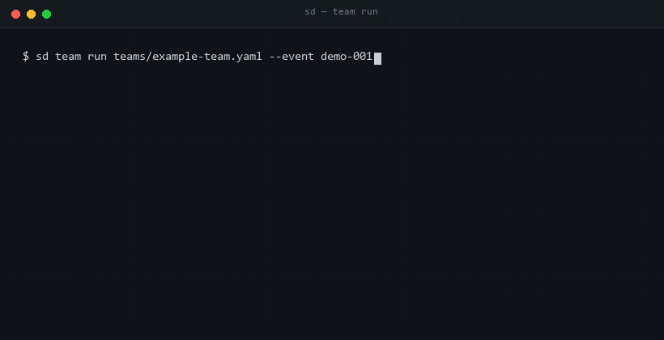
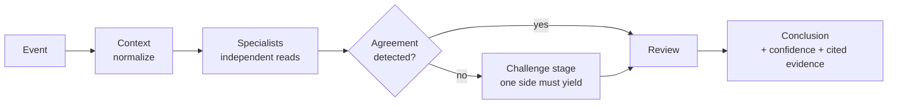

<div align="center">

# SoccerDream Expert Team

**A multi-agent research team that argues with itself, cross-checks every claim, and runs its own post-mortem — before it publishes a single conclusion.**

[**English**](README.md) · [简体中文](README.zh-CN.md)

[](NOTICE.md)
[](NOTICE.md)
[](NOTICE.md#8-no-warranty-no-advice)
[](README.zh-CN.md)

[Live demo](https://soccerdreamai.com) · [Architecture](docs/architecture.md) · [Build a team](teams/) · [Discussions](https://github.com/SoccerDreamAI/soccerdream-experts/discussions) · [Why averaging fails](https://dev.to/soccerdreamai/why-a-multi-agent-system-must-not-average-3p5d)

</div>

---

> **This repository is source-available, not open source.**
> The personas, the orchestration schema, and the client are fully public. The training prompts, evaluation weights, and live data pipeline are not here — they run on the hosted service. See [NOTICE.md](NOTICE.md) before you fork.

<p align="center">
  
</p>

## Why this exists

Most "AI prediction" tools give you one model and one confident answer. That is the wrong shape for any question where being wrong is expensive.

This repo publishes the **team shape** instead: several specialists with genuinely different priors, a structured disagreement protocol, and a review stage that is allowed to overturn the conclusion.

You can read every rule they follow. You can build your own team from the same schema. What you cannot see is the part we consider the product.

## What is public, and what is not

We would rather say this on line one than have you find out at runtime.

| | Contents | In this repo |
|:--|:--|:--:|
| 🟢 **Persona layer** | `agents/` — role definitions, priors, refusal rules | **Full** |
| 🟢 **Orchestration layer** | `teams/` — stages, handoffs, disagreement protocol | **Full** |
| 🟢 **Client layer** | CLI + SDK — installable, inspectable | **Full** |
| 🔴 **Training layer** | Per-model training prompts, evolved wording | Not included |
| 🔴 **Evaluation layer** | Weighting, calibration, scoring internals | Not included |
| 🔴 **Data layer** | Live feed adapters, normalization, history store | Not included |

Everything in the green rows runs unchanged against the hosted API. Nothing in this repo secretly calls a hidden local module — the closed layers are simply absent, not obfuscated.

## Quick start

No install, no account, no network. Python 3.8+ and nothing else:

```bash
git clone https://github.com/SoccerDreamAI/soccerdream-experts
cd soccerdream-experts

python3 cli/sd.py demo                       # the protocol, start to finish
python3 cli/sd.py demo --unresolved          # the run that ends with no conclusion
python3 cli/sd.py validate teams/example-team.yaml
```

`demo` is a **recorded** run: fixed inputs, no model calls. It shows who is allowed to say
what, and what happens when two of them disagree:

```
stage 2/4  specialists  A: range 1.2 - 1.8, 3 citations
                        B: range 2.1 - 2.6, 1 citation
                        -> disagree, zero overlap
stage 3/4  challenge    B challenges A: "your window is too narrow"
                        A cites 3 independent figures -> stands
                        B cites 1, short of 2 -> withdraws, in writing
stage 4/4  review       load-bearing claim rests on 1 source
                        -> confidence high downgraded to medium

conclusion              range 1.2 - 1.8, confidence medium
                        no single outcome named, by design
```

`validate` is not a demo. It checks a team file and every persona it references — the same
contract checks CI runs, with better error messages:

```
$ python3 cli/sd.py validate teams/example-team.yaml
  ok    teams/example-team.yaml
```

Exit code `2` means the file is invalid. Exit code `1` means the run completed and reached
**no conclusion** — a valid outcome here, not an error.

Running a team against live data needs the hosted service. That is a separate thing from this
repository, and this repository will not pretend otherwise: `sd team run` exits `4` and says so.

## How a run works



Each specialist writes its reasoning **before** it sees the others. Disagreement is not averaged away — it is escalated to an explicit challenge stage, where a claim survives only if it can point at evidence.

The full rationale, including why averaging is banned, is in [docs/architecture.md](docs/architecture.md).

## Build your own team

A team is one YAML file plus however many personas you want:

```yaml
# teams/example-team.yaml
name: match-research-team
version: 1

stages:
  - context
  - specialists
  - challenge
  - review

members:
  - ref: agents/quantitative-analyst.md
  - ref: agents/market-odds-reader.md
  - ref: agents/contrarian-hunter.md
  - ref: agents/red-team-reviewer.md

rules:
  independence: strict      # no member sees another's draft
  disagreement: escalate    # never average conflicting reads
  confidence: calibrated    # must cite, or be downgraded
```

See [`agents/_schema.md`](agents/_schema.md) for the persona contract and [`teams/_schema.md`](teams/_schema.md) for every supported field.

## Contributing

Personas are the easiest and most valuable thing to contribute. Read [CONTRIBUTING.md](CONTRIBUTING.md) first — it takes two minutes and will save us both a review cycle.

## License

Dual-licensed, deliberately:

- **Code** (`cli/`, `sdk/`, `teams/`) — Business Source License 1.1. Converts to Apache-2.0 after four years.
- **Docs & personas** (`agents/`, `docs/`, `*.md`) — CC BY-NC-SA 4.0.

Commercial use of either requires a separate license. See [NOTICE.md](NOTICE.md).

**Forking?** [TRADEMARK.md](TRADEMARK.md) lists the three things a fork must do, and — in the
same document — what we cannot enforce and will not pretend to. If you find a copy of this
project presented as the official one, that page tells you where to report it.

## Disclaimer

This project is a **research and analysis framework**. It does not provide betting advice, tips, or recommendations of any kind. Any output is an analytical artifact, not a prediction of a real-world outcome. Nothing here is intended for use by anyone under 18. You are responsible for complying with the laws of your jurisdiction.

---

<div align="center">
<sub>Built by <a href="https://soccerdreamai.com">SoccerDream AI</a> · <a href="https://soccerdreamai.com/?utm_source=github&utm_medium=readme&utm_campaign=experts">Try the hosted version</a></sub>
</div>
