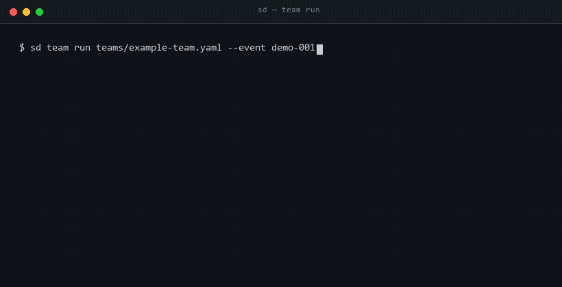
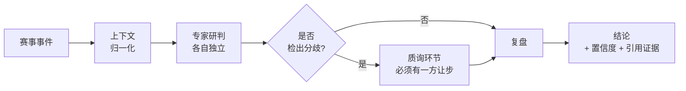

<div align="center">

# SoccerDream 专家团

**一个会互相抬杠、逐条交叉验证、并且在发布结论前先做一次复盘的 AI 研究团队。**

[English](README.md) · [**简体中文**](README.zh-CN.md)

[](NOTICE.md)
[](NOTICE.md)
[](NOTICE.md#8-无担保不构成建议)
[](README.md)

[在线体验](https://soccerdreamai.com) · [架构说明](docs/zh-CN/architecture.md) · [自建团队](teams/) · [讨论区](https://github.com/SoccerDreamAI/soccerdream-experts/discussions)

</div>

---

> **本仓库是「源码可见」，不是「完全开源」。**
> 人设、编排协议、客户端全部公开；训练词、评估权重、实时数据链路不在这里——它们跑在托管服务上。
> 在 fork 之前，请先读 [NOTICE.md](NOTICE.md)。

<p align="center">
  
</p>

## 为什么做这件事

绝大多数「AI 预测」产品给的是**一个模型、一个斩钉截铁的答案**。但凡答错的代价较高的场景，这个形态就是错的。

我们公开的是**团队形态**：几个先验假设真正不同的专家、一套结构化的分歧处理协议、以及一个**有权推翻结论**的复盘环节。

他们遵守的每一条规则你都能读到。你可以用同一套 schema 搭自己的团队。你看不到的，只有我们认定为「产品本体」的那部分。

## 哪些公开，哪些不公开

这句话我们宁可放在第一屏，也不想让你在运行到一半时才发现。

|  | 内容 | 是否在本仓库 |
|:--|:--|:--:|
| 🟢 **人设层** | `agents/` —— 角色定义、先验偏好、拒答规则 | **完整** |
| 🟢 **编排层** | `teams/` —— 阶段、交接、分歧协议 | **完整** |
| 🟢 **客户端层** | CLI + SDK —— 可安装、可审查 | **完整** |
| 🔴 **训练层** | 每个模型的训练词、进化后措辞 | 不提供 |
| 🔴 **评估层** | 权重、校准、打分明细 | 不提供 |
| 🔴 **数据层** | 实时数据适配器、归一化、历史库 | 不提供 |

绿色三行在这里运行，与托管 API 完全一致。本仓库里没有任何「偷偷调用本地隐藏模块」的代码——闭源部分是**缺席**，不是**混淆**。

## 快速开始

```bash
# 安装客户端
pip install soccerdream-experts

# 认证（免费额度，无需绑卡）
sd auth login

# 用已发布的团队跑一场
sd team run teams/example-team.yaml --event demo-001
```

或者用 Node：

```bash
npx soccerdream-experts team run teams/example-team.yaml --event demo-001
```

预期输出：

```
stage 1/4  context     ✓  2 个数据源已归一化
stage 2/4  specialists ✓  4 份独立研判（其中 2 份互相矛盾）
stage 3/4  challenge   ✓  1 条结论被推翻
stage 4/4  review      ✓  结论已发布（置信度：中）
```

## 一次运行是怎么走的



每位专家**在看到他人工件之前**先写完自己的推理。分歧不会被平均掉——它会被升级到明确的质询环节，一条结论只有在能指出具体证据时才能存活。

为什么禁止「取平均」，完整论证在 [docs/zh-CN/architecture.md](docs/zh-CN/architecture.md)。

## 自建一个团队

一个团队 = 一个 YAML 文件 + 任意数量的人设：

```yaml
# teams/example-team.yaml
name: match-research-team
version: 1

stages:
  - context
  - specialists
  - challenge
  - review

members:
  - ref: agents/quantitative-analyst.md
  - ref: agents/market-odds-reader.md
  - ref: agents/contrarian-hunter.md
  - ref: agents/red-team-reviewer.md

rules:
  independence: strict      # 成员之间不互看草稿
  disagreement: escalate    # 冲突不取平均
  confidence: calibrated    # 无证据引用即降级
```

人设契约见 [`agents/_schema.md`](agents/_schema.md)，编排的全部字段见 [`teams/_schema.md`](teams/_schema.md)。

## 参与贡献

**人设是最容易、也最有价值的贡献方式。** 动手前先读 [CONTRIBUTING.zh-CN.md](CONTRIBUTING.zh-CN.md)，两分钟读完，能省掉一轮返工。

## 许可证

刻意做成双许可：

- **代码**（`cli/`、`sdk/`、`teams/`）—— Business Source License 1.1，四年后自动转为 Apache-2.0
- **文档与人设**（`agents/`、`docs/`、`*.md`）—— CC BY-NC-SA 4.0

任何商用场景均需另行取得授权，详见 [NOTICE.md](NOTICE.md)。

**要 fork？** [TRADEMARK.md](TRADEMARK.md) 写清了 fork 必须做的三件事，以及——在同一份文件里——
我们拦不住什么、不会假装能拦什么。如果发现有人把本项目的拷贝说成官方，那一页写了该往哪里举报。

## 免责声明

本项目是一个**研究与分析框架**，不提供任何形式的投注建议、推荐或提示。所有输出均为分析产物，而非对现实结果的预测。本项目不面向 18 岁以下人士。请自行确认所在司法辖区的合规要求。

---

<div align="center">
<sub>由 <a href="https://soccerdreamai.com">SoccerDream AI</a> 构建 · <a href="https://soccerdreamai.com/?utm_source=github&utm_medium=readme_zh&utm_campaign=experts">体验托管版本</a></sub>
</div>
